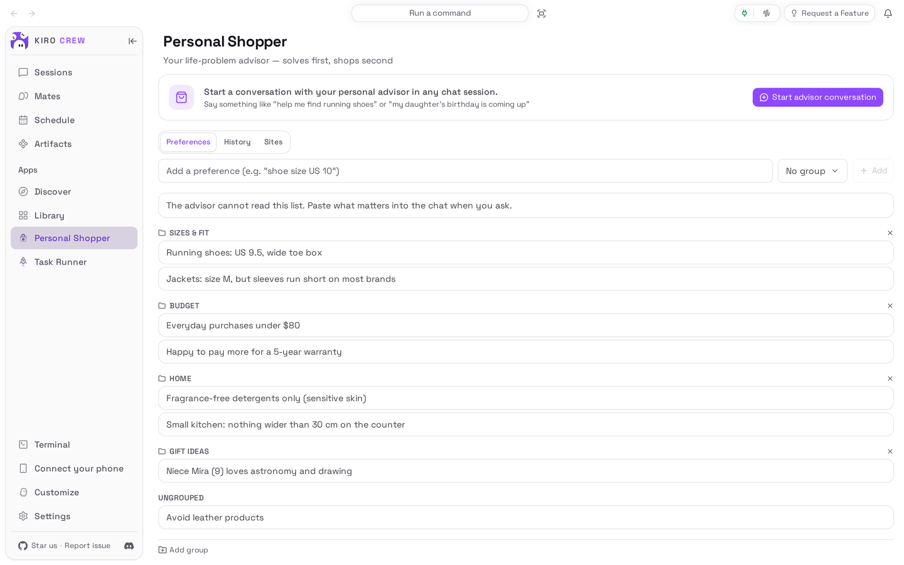
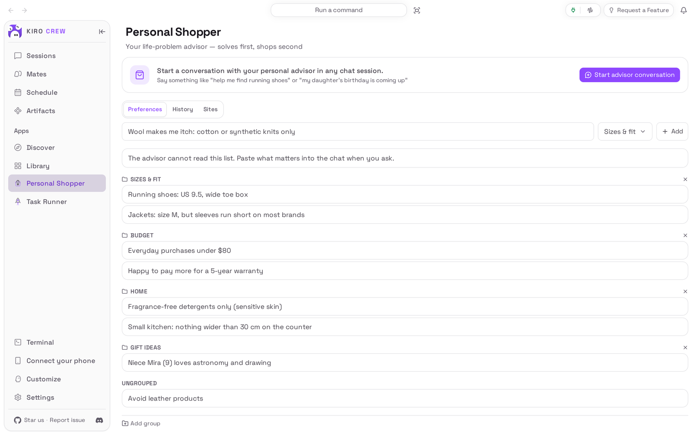
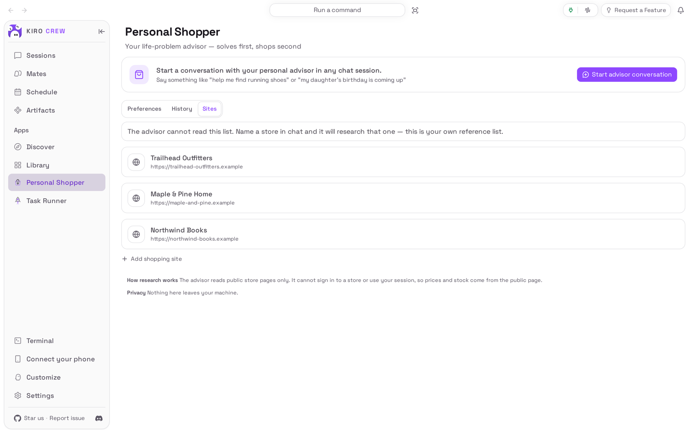
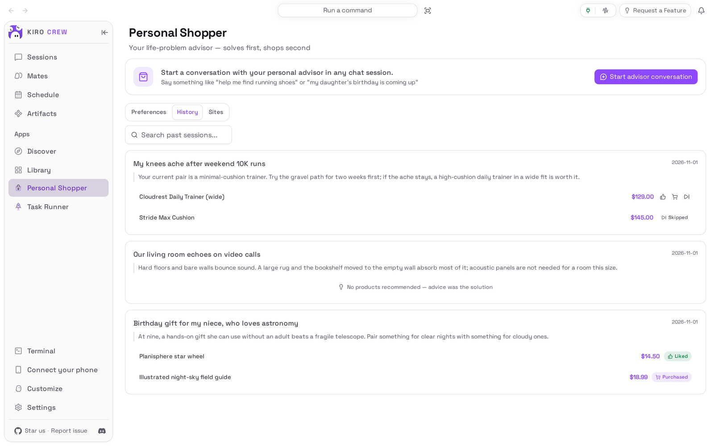
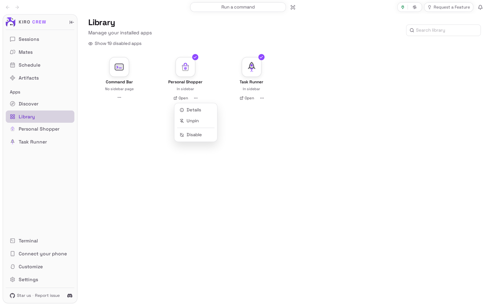

# Personal Shopper

<picture>
  <source media="(prefers-color-scheme: dark)" srcset="docs/media/hero-dark.png">
  
</picture>

**An advisor that works out what you need before it suggests buying anything, and never buys for you.**

Personal Shopper is an app for [Kiro Crew](https://github.com/kirodotdev/KiroCrew),
the open-source personal AI agent.

## What it is

Personal Shopper adds a **Personal Shopper** page to Kiro Crew and an advisor you
chat with. Tell the advisor about a problem, such as a gift you need or a room
that echoes. It works on the real need first, and asks when it needs to know
more. It is told to suggest a product only when buying is actually the best
answer, and it says why each pick fits.

The page also keeps your own lists: **Preferences** (your sizes, budgets and
things to avoid) and **Sites** (the stores you use).

**Get started:** Personal Shopper already comes with Kiro Crew, switched off. Open
**Apps → Library**, choose **Show N disabled apps** (N is how many apps are
switched off), then on the **Personal Shopper** tile open the **⋯** menu and choose
**Enable**. [Install](#install) has the details.

## The problem it solves

Ask for shopping help and you usually get a list of products before anyone asks
what is wrong. Some assistants even go further and act inside a store where you
are signed in.

Personal Shopper works the other way round. The advisor looks at the problem
first. Sometimes the answer is advice with nothing to buy. It looks only at
stores you name, and it leaves every purchase to you: it gives you the link to
open yourself.

It cannot buy anything. The advisor can only search the web and read public web
pages. It cannot click buttons, cannot sign in to your store accounts, and cannot
hand the job to another assistant that could. The app's tests check this
([`tests/test_no_purchase_capability.py`](tests/test_no_purchase_capability.py)).

## Top 3 use cases

### 1. Find a gift or a product that really fits

Your niece turns nine and loves astronomy, and you have $40. Choose **Start
advisor conversation**, say who it is for, your budget and which store to check,
then add what matters (here: no telescope, she draws a lot and likes doing things
on her own). The advisor suggests a few gifts, says why each one fits her, and
picks a combination inside the budget. In this capture it could not read the
store (see the note under [Watch it](#watch-it)), so it gave rough prices and
said it had not checked Northwind Books, instead of making prices up.


### 2. Fix a problem before you spend money

Your living room echoes on video calls and you wonder whether you need acoustic
panels. Describe the problem instead of the product, and say what the room is
like. Here the advisor finds the cause (the bare wall behind you) and lists
fixes best first: turn your seat so the bookshelf is behind you, which costs
nothing, then a rug under the chair or a thick blanket on that wall. It says to
buy panels only if the wall still echoes after that.


### 3. Keep your sizes, budgets and must-avoids in one place

Sleeves always run short on you, you only buy fragrance-free detergent, and your
niece loves astronomy. Write each one down once on the **Preferences** tab and
sort them into groups you make, such as **Sizes & fit** or **Gift ideas**.

The advisor **cannot read this list**. It is your own list: copy the lines that
matter into the chat when you ask for help.



## Watch it


[Watch the walkthrough as a video (MP4)](docs/media/walkthrough.mp4).

<sub>Recorded from a real Kiro Crew dashboard (Kiro Crew `00b527df15`, the copy of
this app that comes with it) with a throwaway home and made-up data. The
advisor's replies in the chats come from a live AI model and will vary. The
capture's gateway approves only read-style tool calls, so it declined the
advisor's web searches, and the stores are made-up sites on the reserved
`.example` domain that cannot be opened, so the advisor read no store page: it
says so, and its prices are its own rough guesses. The waits for the replies are
shortened in the video.</sub>

## Install

**Today: Personal Shopper comes with Kiro Crew.** Nothing needs downloading. It
starts switched off:

1. In Kiro Crew, open **Apps → Library** in the left sidebar.
2. Choose **Show N disabled apps** (N is how many apps are switched off).
3. On the **Personal Shopper** tile, open the **⋯** menu and choose **Enable**.
4. **Personal Shopper** now appears under **Apps** in the sidebar.

**Coming soon: from the Kiro Crew App Store.** Once this app is listed there:

1. Open **Apps → Discover** in the left sidebar.
2. Search for **Personal Shopper** and choose **Install**.
3. Kiro Crew asks **Trust “Personal Shopper” to run its own code?** Personal
   Shopper keeps your lists with a small program of its own. Trusting it gives
   that program the same access Kiro Crew has (your files, your saved sign-ins
   and the internet), as the dialog says. If you are happy with that, choose
   **Trust this app**. You can take it back later in **Settings → Security →
   Third-party apps**.
4. The app installs switched off. Choose **Enable** on its page.

What you need: Kiro Crew on a Mac, Linux or Windows computer, and Kiro Crew must
already be able to chat (if ordinary chats work, the advisor works). You do not
need store accounts, passwords or keys of any kind.

## First run

Open **Personal Shopper** from the sidebar. The **Preferences** tab is empty and
says **No preferences yet**. You do not need to set anything up. You can start a
conversation straight away, or first add a few preferences and the stores you use
so they are ready to copy into a chat.

## How to use it

1. **Add a preference.** On **Preferences**, type it in the
   **Add a preference** box (for example *Running shoes: US 9.5, wide toe box*),
   pick a group if you have made any, and choose **Add**. Use **Add group** to make
   a group. Edit or delete a preference from its row.
2. **Save your stores.** On **Sites**, choose **Add shopping site** and enter a
   name and web address. This is your own list; the advisor cannot see it, so name
   the store in your chat message (step 4).
3. **Start a chat.** Choose **Start advisor conversation**. Kiro Crew opens a new
   chat with the **personal-shopper-advisor**.
4. **Describe the problem, not the product.** Say what is going on, paste the
   preferences that matter, and name the store or stores to check.
5. **Answer its questions.** When it needs more to go on, the advisor asks.
   When buying is the answer, it is told to give each pick as a short card: what
   it is, the price, why it fits, and a link.
6. **Buy it yourself, if you want it.** Open the link. Prices come from the
   store's public page, so check the price you see when signed in.



**About the History tab.** History is meant to list past advice and let you mark
each suggested product **Liked**, **Purchased** or **Skipped**. Today nothing
fills it: the advisor cannot save to it and the page has no button to add a
session, so it stays empty. The picture below shows it with example data.



## Settings & data

- **Where your data lives:** your preferences, groups and history are in
  `preferences.db` and your stores in `sites.json`, both in
  `~/.kiro/crew/apps/personal-shopper/data/` (under `$KIROCREW_HOME` if you set
  it). Nothing on the Preferences, Sites or History tabs is sent anywhere.
- **Your chats** with the advisor are ordinary Kiro Crew chats, saved with your
  other chats. Kiro Crew's memory may remind the advisor of things you told it in
  earlier chats. It is told to say when a fact came from memory.
- **What goes over the internet:** while it researches, the advisor runs web
  searches and reads public store pages, using the same AI model as the rest of
  your Kiro Crew.
- **Who can change the lists:** only the person who set up this Kiro Crew. If
  someone shared their Kiro Crew with you, you can look at the lists but not
  change them.
- **Turn it off:** **Apps → Library**, open the **⋯** menu on Personal Shopper,
  choose **Disable**. Your lists are kept.
- **Remove it** (once it is installed from the App Store): the same menu,
  **Uninstall**. **Keep app data** is ticked; untick it to delete your lists too.
  The copy that comes with Kiro Crew can be switched off but not removed.



## Troubleshooting / FAQ

**The advisor did not use the size I saved on the Preferences tab.**
It cannot read that tab, or the Sites tab. Paste the lines that matter into the
chat. The note above each list says the same.

**Can it buy something for me?**
No. It cannot click anything, so it can never reach a cart or a checkout. If you
ask, it says no and gives you the link.

**The price in the chat is different from the store.**
The advisor reads the store's public page, which can be out of date, regional, or
different from your signed-in price. Check the price on the store's own page.

**It looked at a store I did not mention.**
It is told to look only at stores you name in the chat and to ignore instructions
written on web pages. If it goes elsewhere, tell it to stop, and please report it.

**History is empty.**
That is expected today: nothing adds sessions to it yet (see
[About the History tab](#how-to-use-it)).

**"Couldn't start the conversation (…)"**
Kiro Crew could not open the advisor chat. Look at the plug icon at the top right
of Kiro Crew: green means Kiro Crew is running, red means it has stopped, so start
Kiro Crew again. Also check that Personal Shopper is switched on in **Apps →
Library**, then try again. The text in brackets says what failed.

**"Could not save. Error code: …"**
The change was not saved. If the code is `owner_only`, you are using a Kiro Crew
that someone else set up and shared with you; only they can change these lists.
For any other code, reload the page and try again.

**After installing from the App Store, the page does not appear.**
The app installs switched off. Turn it on from its page or from **Apps → Library**.
If you chose **Cancel** when asked to trust it, choose **Enable** again and then
**Trust this app and enable**.

## Development

This repository is the externally packaged form of the `personal-shopper` app
that ships built into Kiro Crew. The two share a name, a version and the same
permissions, so the Kiro Crew release that adds built-in adoption can move an
existing built-in install onto this source in place, at a commit pinned in that
release: data, settings and the sidebar entry stay where they are. Until a user's
Kiro Crew does that, it keeps running its built-in copy, and nothing here changes
what they run. [PORTING.md](PORTING.md) lists every place this copy differs from
the built-in, and why.

| Path | What it is |
|---|---|
| `app.json` | The app manifest (App Kit `manifest-reference.md`), including the `ui` entry and the `l10n` listing copy |
| `agents/advisor.json` | The `personal-shopper-advisor` agent: `web_search` and `web_fetch` only |
| `skills/personal-shopper/` | The advisor's skill |
| `backend/routes.py` | In-gateway route hooks (`backend.hooks.routes` / `on_shutdown`) |
| `backend/store.py` | The preference store: sqlite, vector search with a keyword fallback |
| `backend/_host.py` | The only module that touches the gateway, and only through the public App Kit context |
| `backend/_fs.py` | Local stand-ins for the file helpers the built-in imported |
| `ui/src/` | The dashboard page (React), built against `@kirocrew/app-sdk` |
| `ui/i18n/` | The page's strings in every language the dashboard ships |
| `ui/dist/index.mjs` | The built page, **committed**: an install is a plain clone with no build step |
| `ui/tests/` | UI tests (vitest + jsdom), with light stand-ins for the host SDK |
| `assets/` | Store icon, hero art and screenshot (raster, as the catalog requires) |
| `tests/` | Backend and manifest tests, runnable offline with pytest |
| `capture/` | Captures the README media from a real, isolated Kiro Crew ([capture/README.md](capture/README.md)) |
| `docs/media/` | The README pictures and walkthrough, plus `media.json` (sizes, alt text, commits) |

### What it needs from Kiro Crew

Kiro Crew 0.12.0 or later (`minKiroCrewVersion`): App Kit level 1, which gives an
app's hooks an owner gate (`ctx.require_owner`), the shared embedder
(`ctx.embed`) and structural route records, and gives its page `Select`,
`guideCaution`, `fmtCurrency` and the `memoryMode` / `sessionFolder` chat-launch
options. Nothing here imports `kiro_crew`; `tests/test_no_host_imports.py` keeps
it that way.

On a gateway without those seams the app still loads, in a reduced form:
`register_routes` reports degraded health, every write is refused with
`owner_only` (there is no gate to ask, so it fails closed), and search ranks by
keyword. The page reads the level-1 names off namespace imports
(`ui/src/hostSdk.ts`) with local fallbacks, so it still renders.

### Install from a clone

```bash
git clone https://github.com/KiroCrewCaptain/kirocrew-app-personal-shopper
kirocrew app install ./kirocrew-app-personal-shopper
```

Then turn it on from **Apps → Library**. The app runs its own code
(`backend.hooks` in `app.json`), so Kiro Crew will not enable it until you trust
it: the Library's **Enable** opens **Trust “Personal Shopper” to run its own
code?**, and **Trust this app and enable** does both. Until it is trusted,
`kirocrew app enable personal-shopper` is refused with `app_execution_denied`;
there is no command-line trust step (the dashboard's dialog calls
`POST /api/security/trusted-apps/personal-shopper`).

While your Kiro Crew still has the built-in copy installed, the install itself is
refused: `app 'personal-shopper' is already installed` (or, on a Kiro Crew that
adopts built-ins, a pending-adoption refusal, because the built-in record is
about to move onto this source by itself). From a terminal,
`kirocrew app disable personal-shopper` turns the app off, and
`kirocrew app uninstall personal-shopper` (add `--purge-data` to delete the lists)
removes an installed copy.

### Routes

The routes are served under `/api/apps/personal-shopper/` while the app is
enabled. The backend is in-gateway Python, which Kiro Crew runs for a
non-built-in app only after the operator trusts it. Every write asks the host's
owner gate first; reads, and requests made with an app token the gateway already
confined to this app's `permissions.api`, do not.

### Tests

Backend and manifest:

```bash
python -m pip install -r tests/requirements.txt
python -m pytest
```

These need neither Kiro Crew nor the network: `tests/harness.py` serves the
routes the way the gateway's route registry does, with a stand-in `AppContext`
(owner gate, deterministic embedder, App Kit level). Test dependencies live in
`tests/requirements.txt` on purpose: a `requirements.txt` at the repository root
would make a registry install run pip into the gateway's interpreter.

UI (Node 24, from `ui/`):

```bash
npm ci
npm run typecheck
npm test
npm run build
```

`npm run build` writes `ui/dist/index.mjs`. Commit it with the source change that
produced it: CI rebuilds it from a clean `npm ci` and fails if the result differs
from the committed file. The bundle imports only the seven modules the dashboard
provides (React, ReactDOM, the JSX runtime, `lucide-react`,
`@tanstack/react-query`, `@kirocrew/app-sdk` and `@kirocrew/app-sdk/ui`);
`tests/test_manifest_contract.py` checks that, and that every name it imports by
name exists on a Kiro Crew without the level-1 seams. A UI string is added to
`ui/i18n/en.json` and every other catalog there; `ui/tests/i18n.test.ts` fails on
a locale missing a key. The listing copy in `app.json` (`displayName`,
`description`, `highlights` and `l10n`) is the catalogs' `manifest` subtree, and a
test keeps the two equal.

### Re-capture the README media

The pictures and the recording come from a real Kiro Crew dashboard on an isolated
gateway (throwaway home, loopback port). The fictional demo data in
[`capture/scenes.json`](capture/scenes.json) goes in through this app's own HTTP
API. The chats (the scenes marked `"live"`) run the advisor on a real model
through your own installed, signed-in `kiro-cli` with model `auto`, so its replies
vary from run to run and each run uses some of your credits; the capture stops if
`kiro-cli` is not signed in. Every other picture uses Kiro Crew's offline stub
backend (`capture/stub_backend.py`). After anything the app shows changes:

```bash
python -m pip install playwright && python -m playwright install chromium
python capture/capture.py --kirocrew /path/to/KiroCrew --python /path/to/KiroCrew/.venv/bin/python
python capture/check_readme.py
```

The Kiro Crew checkout needs its dashboard built and staged first, and `ffmpeg`
must be on `PATH` ([capture/README.md](capture/README.md) has the details). Until
Kiro Crew stops shipping the built-in copy, the capture photographs that copy.
Look at every image and at a few frames of the video before committing, then read
what the advisor said and make the alt text and this README say only that; see
[CHECKLIST.md](CHECKLIST.md).

## License

Apache License 2.0. See [LICENSE](LICENSE) and [NOTICE](NOTICE).
